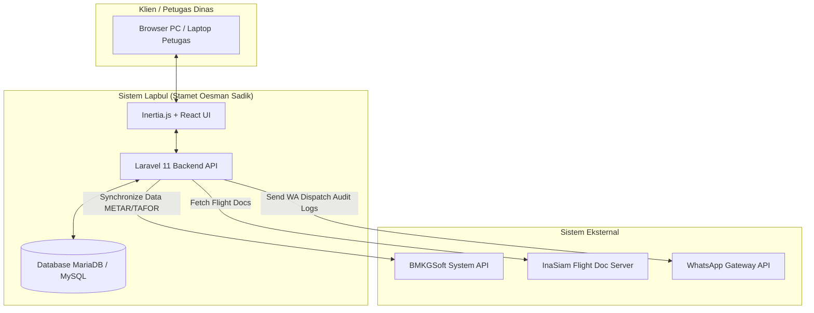

# Spesifikasi Kebutuhan Sistem (System Requirements Specification - SRS)
## Sistem Laporan Bulanan (Lapbul) & Penjadwalan Operasional
### Stasiun Meteorologi Oesman Sadik Halmahera Selatan (WAEL / 97460)

---

## 1. Pendahuluan

### 1.1 Latar Belakang
Stasiun Meteorologi Oesman Sadik Halmahera Selatan bertanggung jawab atas pengamatan cuaca rutin, penerbitan informasi cuaca penerbangan, klimatologi, serta pelaporan operasional bulanan ke Badan Meteorologi, Klimatologi, dan Geofisika (BMKG). Proses pencatatan jadwal piket dinas, kompilasi data pengamatan harian/jam-jaman, serta validasi laporan bulanan secara manual rentan terhadap ketidaksesuaian data, penurunan akurasi, dan waktu pemrosesan yang lama. 

Sistem **Lapbul** dikembangkan untuk mendigitalkan seluruh alur kerja operasional, mulai dari penjadwalan dinas pegawai (PNS & PPNPN), pencatatan data observasi meteorologi/aviasi, penjaminan mutu data (Quality Control), hingga pembuatan rekapitulasi laporan bulanan secara otomatis dan terintegrasi.

### 1.2 Tujuan
- Menyediakan platform terpusat untuk mengelola data pegawai, hak akses, dan penjadwalan shift operasional harian.
- Memfasilitasi entri data observasi meteorologi (Sinoptik, METAR, TAFOR, PIBAL, MET REPORT, Klimatologi, Perawanan, Penguapan) dengan validasi otomatis.
- Mengotomatiskan rekapitulasi dan pembuatan dokumen laporan bulanan yang siap dicetak/diespor.
- Meningkatkan akurasi dan akuntabilitas melalui audit log petugas piket (Observer, Teknisi, dan PPNPN).

---

## 2. Kebutuhan Fungsional (Functional Requirements)

### 2.1 Modul Manajemen Kepegawaian & Autentikasi (FR-01)
- **FR-01.1**: Sistem harus dapat mengelola data profil pegawai PNS dan PPNPN (NIP, Nama, Email, Role, Jabatan Fungsional, Pangkat, Golongan, Tanggal Masuk Kerja, Status Aktif).
- **FR-01.2**: Sistem harus mendukung autentikasi aman berbasis kata sandi, *Two-Factor Authentication* (2FA), dan *Passkey (Biometric/FIDO2)*.
- **FR-01.3**: Sistem harus menerapkan *Role-Based Access Control* (RBAC) untuk membatasi hak akses sesuai peran (misal: Kepala Stasiun, Tata Usaha, Observer & Forecaster, Teknisi, PPNPN).

### 2.2 Modul Penjadwalan Dinas & Shift Bulanan (FR-02)
- **FR-02.1**: Sistem harus dapat mengelola Master Shift untuk kategori `operasional`, `teknisi`, dan `ppnpn` (kode shift, nama shift, jam masuk, jam keluar, indikator tidak masuk kerja).
- **FR-02.2**: Sistem harus dapat membuat Dokumen Jadwal Bulanan untuk periode bulan dan tahun tertentu dengan penetapan Kepala Stasiun dan Kepala Pokjung.
- **FR-02.3**: Sistem harus secara otomatis menyalin (*snapshot*) master shift ke dalam `jadwal_bulanan_shifts` saat jadwal periode baru dibuat.
- **FR-02.4**: Sistem harus menyediakan antarmuka kalender/matriks interaktif untuk menetapkan shift harian kepada pegawai (`jadwal_details`).
- **FR-02.5**: Sistem harus mencegah duplikasi penjadwalan pegawai pada tanggal yang sama (*unique constraint* per pegawai per hari).

### 2.3 Modul Entri & Observasi Data Meteorologi Surface & Aviasi (FR-03)
- **FR-03.1 (Sinoptik)**: Sistem harus menyediakan formulir entri data Sinoptik jam-jaman (Suhu Bola Kering/Basah/Max/Min, RH, Tekanan QFF/QFE, Angin, Visibility, Curah Hujan, Cuaca WW/W1/W2, jenis & lapisan awan 1–4, evaporasi, radiasi) dan menghasilkan sandi Synop terenkode.
- **FR-03.2 (METAR & SPECI)**: Sistem harus dapat mencatat sandi METAR/SPECI, waktu terima/kirim, delay (menit), status pengiriman, serta terintegrasi dengan data BMKGSoft.
- **FR-03.3 (TAFOR)**: Sistem harus dapat mencatat sandi prakiraan cuaca bandara (TAFOR) periode 9/12/24 jam beserta metadata pengiriman.
- **FR-03.4 (PIBAL)**: Sistem harus dapat menyimpan data pengamatan angin atas balon pilot, meliputi pembacaan azimuth & elevasi per menit/lapisan, serta kalkulasi otomatis arah dan kecepatan angin (`dddff`).
- **FR-03.5 (MET REPORT / QAM)**: Sistem harus dapat mencatat Laporan Cuaca Bandara WAEL (Wind, Visibility, Weather, Cloud, Temp, Dewpoint, QNH, QFE, Trend, Remarks).

### 2.4 Modul Dokumentasi Penerbangan & WhatsApp Dispatch (FR-04)
- **FR-04.1**: Sistem harus dapat membuat dan mengelola *Flight Document* (Nomor FD, Nomor Penerbangan, Maskapai, Rute, Jam Keberangkatan, Jam Terbit, Flight Level, Tipe, Status, URL Berkas).
- **FR-04.2**: Sistem harus mencatat riwayat audit pengiriman WhatsApp (*is_wa_dispatched*, timestamp pengiriman, nama pengirim/sender).

### 2.5 Modul Data Klimatologi, Perawanan & Penguapan (FR-05)
- **FR-05.1 (F-Klim)**: Sistem harus dapat menginput Form Klimatologi harian (Suhu jam 07, 13, 18, Rata-rata, Max, Min, Hujan jam 07, Penyinaran Matahari 8 jam, RH 07/13/18, Kecepatan & Arah Angin Maksimum).
- **FR-05.2 (Perawanan)**: Sistem harus mencatat jumlah observasi kondisi langit (*clear*, *partly cloudy*, *cloudy*, *totally cloudy*) harian/bulanan.
- **FR-05.3 (Penguapan)**: Sistem harus mencatat selisih pembacaan Panci Penguapan Terbuka (Phet), suhu air max/min/rata-rata, hujan, nilai evaporasi (mm), dan kecepatan angin anemometer 0.5 meter.

### 2.6 Penjaminan Mutu & Akuntabilitas Petugas Piket (FR-06)
- **FR-06.1**: Sistem harus mencatat tiga penanggung jawab petugas pada setiap entri pengamatan (`pegawai_id` untuk Observer, `teknisi_id` untuk Teknisi, dan `ppnpn_id` untuk PPNPN).
- **FR-06.2**: Sistem harus menyediakan fitur *Quality Control (QC Flag)* dan catatan riwayat perubahan (*QC Histories*) pada data pengamatan.

### 2.7 Modul Pelaporan Bulanan & Ekspor Data (FR-07)
- **FR-07.1**: Sistem harus menyediakan dasbor rekapitulasi ketepatan waktu pengamatan (monitoring delay & *monitoring_status*).
- **FR-07.2**: Sistem harus dapat mengekspor rekapitulasi data harian/bulanan ke format PDF dan Excel (.xlsx) sesuai standar format laporan bulanan BMKG.

---

## 3. Kebutuhan Non-Fungsional (Non-Functional Requirements)

### 3.1 Performa & Efisiensi (NFR-01)
- Waktu respons halaman web (*Page Load Time*) tidak boleh melebihi 2 detik pada jaringan lokal/standar stasiun.
- Pencarian dan pembuatan rekapitulasi data bulanan (hingga 1.000+ baris data observasi) harus selesai di bawah 3 detik.

### 3.2 Keamanan & Proteksi Data (NFR-02)
- Seluruh lalu lintas data menggunakan protokol terenkripsi HTTPS.
- Kata sandi disimpan menggunakan algoritma *hashing* aman (Bcrypt / Argon2).
- Proteksi terhadap kerentanan OWASP Top 10 (CSRF Protection, SQL Injection Escaping, XSS Sanitization, Rate Limiting).
- Sesi aktif pengguna (*session timeout*) otomatis berakhir setelah 120 menit tidak ada aktivitas.

### 3.3 Keandalan & Ketersediaan (NFR-03)
- Ketersediaan sistem (*System Availability*) minimal 99.5% untuk mendukung operasional dinas 24/7.
- Sistem menerapkan mekanisme penanganan transaksi database (*Database Transactions*) untuk mencegah data korup saat penyimpanan gagal.

### 3.4 Antarmuka & Usabilitas (NFR-04)
- Antarmuka berbasis *Responsive Web Design* yang responsif pada layar PC desktop, laptop, dan tablet.
- Desain UI/UX modern berbasis tema *Dark Mode / Light Mode* yang nyaman digunakan petugas piket malam (*Shift Malam*).

---

## 4. Kebutuhan Lingkungan & Spesifikasi Teknologi

### 4.1 Perangkat Lunak Server (Server Software Requirements)
| Komponen | Spesifikasi Minimum | Spesifikasi Rekomendasi |
| :--- | :--- | :--- |
| **Operating System** | Ubuntu Server 22.04 LTS / Windows Server 2022 | Ubuntu Server 24.04 LTS / Windows Server |
| **Web Server** | Nginx 1.18+ / Apache 2.4+ | Nginx 1.26+ |
| **Runtime Environment** | PHP 8.2+ | PHP 8.3+ |
| **Database Engine** | MySQL 8.0+ / MariaDB 10.6+ | MariaDB 10.11 LTS / MySQL 8.4 LTS |
| **Node.js Environment** | Node.js v18.x | Node.js v20.x LTS |
| **Framework Backend** | Laravel 11.x | Laravel 11.x |
| **Frontend Stack** | Inertia.js + React / TypeScript | Inertia.js + React + Tailwind CSS |

### 4.2 Perangkat Keras Server (Server Hardware Requirements)
| Komponen | Minimum | Rekomendasi |
| :--- | :--- | :--- |
| **Processor (CPU)** | 2 Cores (2.0 GHz) | 4 Cores (2.5 GHz+) |
| **Memory (RAM)** | 4 GB RAM | 8 GB RAM / 16 GB RAM |
| **Storage** | 40 GB SSD / NVMe | 100 GB NVMe SSD |
| **Jaringan** | 10 Mbps Bandwidth | 50 Mbps Bandwidth |

### 4.3 Perangkat Keras Client (Petugas Piket)
- Komputer PC / Laptop dengan RAM minimal 4 GB.
- Browser modern (Google Chrome 110+, Microsoft Edge 110+, Mozilla Firefox 110+).
- Koneksi LAN / Wi-Fi Stasiun.

---

## 5. Matriks Integrasi Sistem Eksternal

---

## 6. Penutup & Persetujuan

Dokumen *System Requirements Specification* ini menjadi acuan utama pengembangan, pengujian (*testing*), serta serah terima sistem **Lapbul** pada Stasiun Meteorologi Oesman Sadik Halmahera Selatan. Setiap perubahan kebutuhan di kemudian hari harus melalui proses evaluasi persetujuan (*Change Request*).
